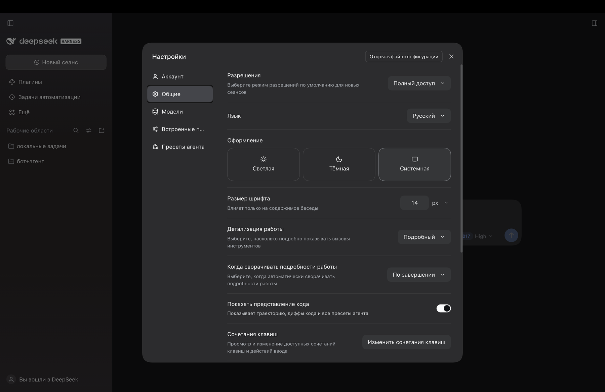
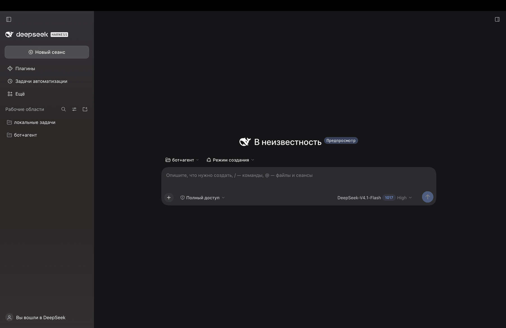

# dsh-locale-ru

**Russian language pack for [DeepSeek Harness](https://github.com/deepseek-ai/deepseek-harness).**

[Русская версия](README.ru.md) · MIT · DeepSeek Harness `0.2.x`


DeepSeek Harness ships with English and Chinese (`zh`) only. This package registers a third
language, `ru` («Русский»), and ships a dictionary for **every** namespace that exposes
localization strings in the current build.

It is an external **client plugin**, not an application setting: nothing is patched inside the
app, and removing the package restores the previous behavior.

> **Compatibility note (7 Nov 2026):** DSH `0.2.2-rc.1` ships its own `ru` locale (together with
> `ja`, `es`, `fr`, `de`, `pt`). The locale service rejects a second registration of the same
> language and namespace, so this pack does not load on `0.2.2-rc.1` — it was built and verified
> against `0.2.1-rc.5`. An overlay release (`ru-native`, fallback `ru`) is being prepared.

**Coverage: 65 of 65 namespaces, 2,914 strings** — verified against the `0.2.1-rc.5` build with
`tools/check.mjs --reference`, which compares every key and every `{placeholder}` with the English
source. Untranslated keys (if a future build adds any) fall back to English, so the UI is never
broken; the reference check is what turns a version bump into a diff instead of a guess.

## Screenshots

Settings → General → Language, with «Русский» selected:



The interface itself, in Russian:



---

## Install

A quick note on how it mounts: the pack is a *bundle*. The profile must list it in
`dsh.profile.bundles`, and the package itself must be resolvable from the profile's
`node_modules`. The install script performs both writes plus a symlink, which is exactly
what a package manager would do:

```sh
node tools/install.mjs --profile desktop
# roll back:
node tools/install.mjs --profile desktop --uninstall
```

- `--home` overrides `$DSH_HOME` (default `~/.dsh`).
- `--profile` selects the DSH profile name.

After installing:

1. with HMR enabled (Desktop profile) the composition is rebuilt on the fly;
2. **reload the page** — the browser has to receive a new `window.__DSH_BOOT__` that
   includes the language bundle;
3. open **Settings → General → Language → Русский**. The choice is stored in the profile's
   host settings and applied immediately.

To roll back: `--uninstall`, reload the page, pick another language.

---

## How it works

| Path | Purpose |
|---|---|
| `package.json` | manifest: `dsh.bundle.patch` (bundle layer) and `dsh.client` (browser half) |
| `cordis.patch.yml` | bundle patch: a single `locale-ru` row mounting the package into the tree |
| `lib/index.js` | host half: an empty plugin, needed only for the composition row |
| `lib/client.js` | **generated** bundle: `addLanguage({ id: 'ru', … })` + dictionaries |
| `dictionaries/<namespace>.json` | translation sources, one file per namespace |
| `GLOSSARY.md` | glossary and translation rules (terms, placeholders, formatting) |
| `tools/build-client.mjs` | builds `lib/client.js` from `dictionaries/` |
| `tools/check.mjs` | checks without launching the app, including reference parity |
| `tools/extract-reference.cjs` | pulls English dictionaries out of an installed build (`app.asar`) |
| `tools/install.mjs` | installs/removes the pack in a DSH profile |

The bundle patch is three lines:

```yaml
- insert:
    - id: locale-ru
      name: dsh-locale-ru
```

The generated client half registers the language with the locale service; each dictionary
file registers under the namespace its owning package uses (`locale.register(ns, {zh, en})`).
The file name **must** match the namespace exactly, otherwise the dictionary is never found
and the whole namespace stays English.

---

## Development

```sh
node tools/build-client.mjs                    # dictionaries/*.json -> lib/client.js
node tools/check.mjs                           # structure, bundle load, apply()
node tools/check.mjs --reference ./reference   # + key and placeholder parity
```

`lib/client.js` is generated — edit `dictionaries/*.json`, never the bundle itself.

To produce the reference for the installed build:

```sh
node tools/extract-reference.cjs "<path-to>/app.asar" .recon/en
node tools/check.mjs --reference .recon/en
```

`--reference <dir>` points at a directory of English dictionaries (`<namespace>.json`)
extracted from an installed DSH build. Without it, `check.mjs` validates structure, JSON
validity, bundle loading and `apply()` calls; with it, it additionally verifies that the key
sets match the English source and that **every `{placeholder}` survived translation**.

Requirements: Node.js 20.11+ (uses `import.meta.dirname`), no other dependencies.

---

## Limitations

- Only namespaces that have dictionaries in the DSH build are translated. Strings hardcoded
  outside the dictionaries stay English.
- Pluralization and word order are outside the locale API: dictionaries return ready-made
  strings, so forms like «1 задача / 2 задачи» have to be split into separate keys.
- `sidebarExcel.language` is intentionally left as `"en"`: the spreadsheet engine registers
  only the English locale, and `"ru"` there would break number and date formatting.
- `ru` is not part of the shipped language set, so it exists only while this package is
  installed. After removal, a saved `ru` choice falls back to the browser language.
- Coverage is version-specific: the dictionaries track a DSH build. Strings added in later
  builds stay English until they are translated, and the reference check is what surfaces them.

---

## Contributing

Corrections, terminology suggestions and new namespace translations are welcome:

1. edit `dictionaries/<namespace>.json` (keep the glossary in `GLOSSARY.md` in sync);
2. run `node tools/build-client.mjs` and `node tools/check.mjs --reference ./reference`;
3. open a pull request with a short description of what changed.

Found a string that stays English? That is usually a string outside the dictionaries — open
an issue with the screen and text, and it can be reported upstream.

## License

MIT © 2026 tenkrol
