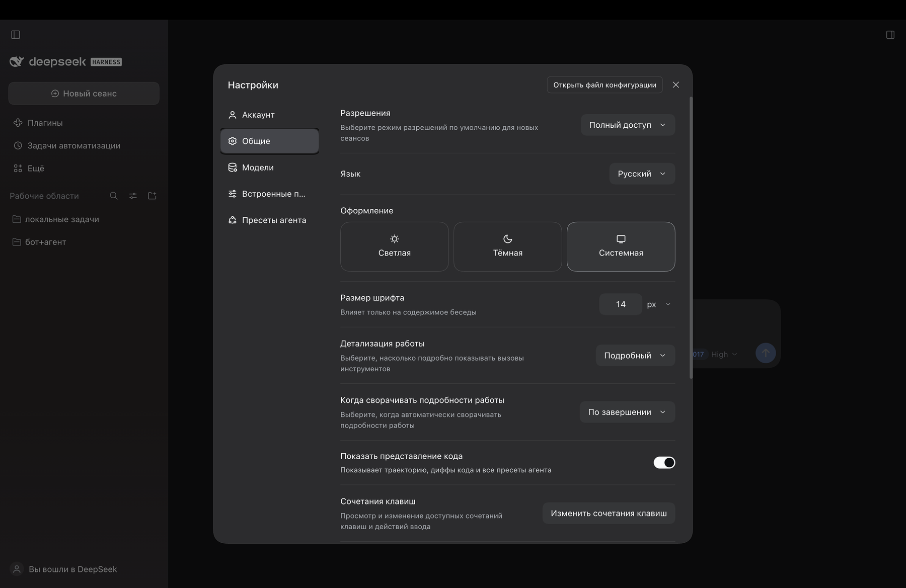
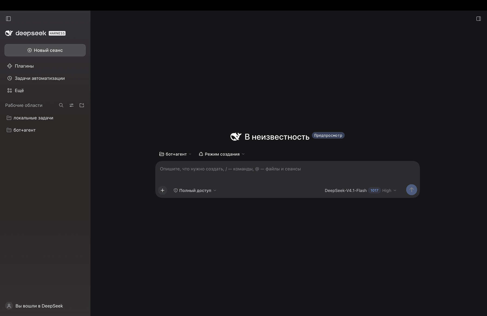

# dsh-locale-ru — нативный русский для DeepSeek Harness

[English version](README.md) · MIT · DSH `0.2.2-rc.1+`

В DSH `0.2.2` появился встроенный русский — машинный перевод. Этот пакет добавляет второй,
написанный вручную язык — **«Русский (нативный)»** (`ru-native`) — и падает во встроенный
русский (`ru`) для всего, что ещё не переведено.

Это внешний клиентский плагин: приложение не патчится, при удалении пакета всё возвращается
к прежнему поведению.

## Скриншоты

Settings → General → Language с выбранным «Русский (нативный)»:



Сам интерфейс на русском:



---

## Покрытие

| | Нативный (`ru-native`) | Встроенный (`ru`) |
|---|---|---|
| namespace'ов | **70 из 73** | 73 |
| строк | **3 175** | 3 830 |
| источник | ручная работа по глоссарию | машинный перевод |

Три панели пока не переведены и берутся из встроенного русского: `forgePanel`, `liveshare`,
`stats`. Всё остальное — настройки, чат, менеджер плагинов, каталог, расписание, траектория,
голосовой ввод, разрешения — нативное.

`tools/check.mjs --reference` сверяет каждый ключ и каждый `{плейсхолдер}` с английским
источником установленной сборки, поэтому обновление DSH превращается в дифф, а не в догадку.

---

## Установка

Пакет — это бандл: профиль должен перечислить его в `dsh.profile.bundles`, а сам пакет — лежать
в `node_modules` профиля. Скрипт делает обе записи и ссылку:

```sh
node tools/install.mjs --profile desktop
# откат:
node tools/install.mjs --profile desktop --uninstall
```

- `--home` переопределяет `$DSH_HOME` (по умолчанию `~/.dsh`).
- `--profile` — имя профиля.

После установки **перезагрузите страницу** (браузеру нужен новый `window.__DSH_BOOT__`), затем
**Settings → General → Language** и выберите **«Русский (нативный)»**. Встроенный «Русский»
остаётся доступным; переключение применяется сразу.

---

## Как устроено

| Путь | Назначение |
|---|---|
| `package.json` | манифест: `dsh.bundle.patch` (бандл-слой) и `dsh.client` (браузерная половина) |
| `cordis.patch.yml` | патч бандла: одна строка `locale-ru`, монтирующая пакет в дерево |
| `lib/index.js` | host-половина: пустой плагин, нужен только для строки композиции |
| `lib/client.js` | **сгенерированный** бандл: `addLanguage({ id: 'ru-native', fallback: 'ru' })` + словари |
| `dictionaries/<namespace>.json` | исходники перевода, по файлу на namespace |
| `GLOSSARY.md` | глоссарий и правила перевода |
| `tools/build-client.mjs` | собирает `lib/client.js` из `dictionaries/` |
| `tools/check.mjs` | проверки без запуска приложения, включая паритет с эталоном |
| `tools/extract-reference.cjs` | выгружает английские словари из установленной сборки (`app.asar`) |
| `tools/install.mjs` | установка/удаление пакета в профиле DSH |

Язык регистрируется как оверлей:

```js
ctx.locale.addLanguage({ id: 'ru-native', label: 'Русский (нативный)', fallback: 'ru' })
ctx.locale.register(namespace, 'ru-native', dictionary)
```

Поиск идёт по цепочке `ru-native → ru → en`. Поэтому непереведённые ключи никогда не пустые:
они падают во встроенный русский, затем в английский. Регистрация обёрнута в `ctx.effect(...)`,
так что удаление бандла убирает язык целиком.

Имена файлов обязаны совпадать с namespace, который регистрирует пакет-владелец
(`locale.register(ns, { zh, en, … })`). Иначе namespace молча останется в резервном языке.

---

## Разработка

```sh
node tools/build-client.mjs                    # dictionaries/*.json -> lib/client.js
node tools/check.mjs                           # структура, загрузка бандла, apply()
node tools/check.mjs --reference .recon/en     # + паритет ключей и плейсхолдеров
```

`lib/client.js` генерируется — правьте `dictionaries/*.json`, а не его.

Эталон для установленной сборки:

```sh
node tools/extract-reference.cjs "<путь>/app.asar" .recon/en
```

`--reference <dir>` — каталог с английскими словарями (`<namespace>.json`), снятыми с
установленной сборки DSH. Без него `check.mjs` проверяет структуру, корректность JSON,
загрузку бандла и вызовы `apply()`; с ним — дополнительно совпадение набора ключей с
английским и сохранность всех `{плейсхолдеров}`.

Требования: Node.js 20.11+ (`import.meta.dirname`), других зависимостей нет.

---

## Ограничения

- **Нужен DSH `0.2.2-rc.1` или новее**: оверлей падает во встроенный `ru`, которого в более
  ранних сборках нет. На `0.2.1-rc.5` пакет регистрировал `ru` сам — этот режим больше
  невозможен, сервис локализации запрещает повторную регистрацию того же id.
- Три namespace'а пока берутся из встроенного русского: `forgePanel`, `liveshare`, `stats`.
- Плюрализация и порядок слов — вне API локали: словари возвращают готовые строки, поэтому
  формы вроде «1 задача / 2 задачи» разводятся ключами.
- `sidebarExcel.language` оставлен `"en"`: движок таблиц регистрирует только английскую
  локаль, `"ru"` там сломал бы форматирование чисел и дат.
- Строки, зашитые в код вне словарей, остаются английскими в любом языке.

---

## Участие

Правки, предложения по терминам и новые namespace'ы приветствуются:

1. правите `dictionaries/<namespace>.json` (глоссарий в `GLOSSARY.md` держите в синхроне);
2. `node tools/build-client.mjs` и `node tools/check.mjs --reference ./reference`;
3. pull request с коротким описанием изменений.

## Лицензия

MIT.
